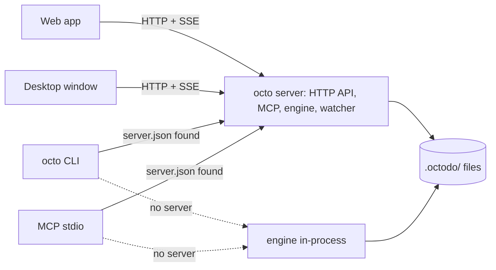

# Architecture

This page explains which process and which package does what. It describes the code as it is today
and the target the Architecture overhaul list (in this repo's `.octodo/`) is moving to. Update the
"Today" sections as each step of the overhaul lands, and delete a "Target" section once it is true.

## Processes

### Today

Every surface opens `.octodo/` itself and runs its own copy of the engine and its cache:

- `octo <command>` runs the engine in-process for one command (`packages/cli/src/main.ts`).
- `octo mcp` runs the engine in-process with a file watcher and serves MCP over stdio.
- `octo serve` runs the HTTP server: the API at `/api`, MCP at `/mcp`, the change feed, the web app.
- The desktop app runs the same server inside Electron's main process (`apps/desktop/src/main.ts`).
  When `octo serve` already holds port 4520, it starts a second server on a random port.

Several processes can open one workspace, so each write holds the workspace's owner lock
(`.octodo/.owner-lock`, [0003](decisions/0003-one-writer-per-workspace.md)) and the others wait for
it. The holder assigns new ids from its own scan.

### Target

- One server per machine serves the web app, the desktop window and MCP over HTTP.
- The CLI and stdio MCP use it when `<home>/server.json` points at a live server, and run the
  engine in-process when there is none ([0002](decisions/0002-server-preferred-topology.md)).
- One process at a time holds a workspace's owner lock and writes
  ([0003](decisions/0003-one-writer-per-workspace.md)).
- The desktop app attaches to the server or spawns it as a child process.

## Packages

### Today

| Package           | What                                                                                                                                                                                                                                                                                                                                                                                                                                                                                                                                                                                                                                                                                                                                                                                                                                                                                                                                                                                                                                                                                                                                                                                                                                                                                                                                            |
| ----------------- | ----------------------------------------------------------------------------------------------------------------------------------------------------------------------------------------------------------------------------------------------------------------------------------------------------------------------------------------------------------------------------------------------------------------------------------------------------------------------------------------------------------------------------------------------------------------------------------------------------------------------------------------------------------------------------------------------------------------------------------------------------------------------------------------------------------------------------------------------------------------------------------------------------------------------------------------------------------------------------------------------------------------------------------------------------------------------------------------------------------------------------------------------------------------------------------------------------------------------------------------------------------------------------------------------------------------------------------------------- |
| `packages/core`   | Effect domain: schemas, markdown round-trip, folder rules, `Workspace` and `Workspaces`. `storage/` is the only code that touches the disk ([0012](decisions/0012-only-storage-touches-the-disk.md)): `storage.ts` is `makeStorage(root)`, whose `read` returns `{ config, tree }` and whose `write((files, ids) => ...)` runs under the owner lock with the only operations that change files and the only source of new task ids; `files.ts` those operations (atomic writes, folders built under a dot name, each reporting the paths it touched to the cache) and the temporary names; `config.ts` the one reader of `config.json`; `tree.ts` the one reader of the folder grammar (task, list and markdown entries with their texts, which writes edit instead of opening a file again, and what the grammar does not read as problems, at most 32 file system calls at once per process, through a cache that writes and the watcher invalidate); `owner-lock.ts` the owner lock; `bookkeeping.ts` octodo's dot names and the cleanup of a crashed write's leftovers; `home.ts` `<home>/workspaces.json` and the folder picker's listing. `scan.ts` is a pure function from a storage read to a snapshot; the workspace gives new ids to files without one in a write. `@octodo/core/layout` is plain functions the browser also imports. |
| `packages/mcp`    | MCP tools on Effect's `McpServer`, stdio and HTTP layers                                                                                                                                                                                                                                                                                                                                                                                                                                                                                                                                                                                                                                                                                                                                                                                                                                                                                                                                                                                                                                                                                                                                                                                                                                                                                        |
| `packages/server` | Hono HTTP API, MCP mount, SSE change feed, static web app on 127.0.0.1; `./client` is the typed Hono RPC client                                                                                                                                                                                                                                                                                                                                                                                                                                                                                                                                                                                                                                                                                                                                                                                                                                                                                                                                                                                                                                                                                                                                                                                                                                 |
| `packages/cli`    | `octo` on `effect/cli`                                                                                                                                                                                                                                                                                                                                                                                                                                                                                                                                                                                                                                                                                                                                                                                                                                                                                                                                                                                                                                                                                                                                                                                                                                                                                                                          |
| `apps/web`        | Vite and React; imports types from core plus `@octodo/core/layout`                                                                                                                                                                                                                                                                                                                                                                                                                                                                                                                                                                                                                                                                                                                                                                                                                                                                                                                                                                                                                                                                                                                                                                                                                                                                              |
| `apps/desktop`    | Electron shell                                                                                                                                                                                                                                                                                                                                                                                                                                                                                                                                                                                                                                                                                                                                                                                                                                                                                                                                                                                                                                                                                                                                                                                                                                                                                                                                  |

### Target

Packages depend in one direction: `contract` ← `engine` ← `server`, with `client` choosing between
the server and an embedded engine, and `plugins` split into `shared`, `engine` and `web` entries
([0004](decisions/0004-packages-by-dependency-direction.md)). Operations are declared once in
`contract` and the HTTP API, MCP tools and CLI commands are generated from them
([0005](decisions/0005-one-operation-catalog.md)). The HTTP layer is Effect HttpApi, and Hono is
deleted ([0006](decisions/0006-effect-httpapi-replaces-hono.md)).

## Extensibility

Task kinds are first-party plugins that each workspace enables in its `config.json`. The plain task
is the built-in kind, registered through the same API
([0007](decisions/0007-first-party-plugins-per-workspace.md)). Presets are data copied into a new
workspace's `config.json` ([0008](decisions/0008-statuses-per-workspace-presets-as-data.md)).
