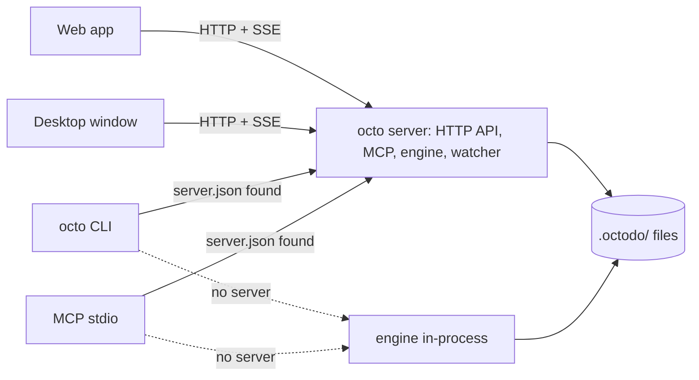

# Architecture

This page explains which process and which package does what. It describes the code as it is today
and the target the Architecture overhaul list (in this repo's `.octodo/`) is moving to. Update the
"Today" sections as each step of the overhaul lands, and delete a "Target" section once it is true.

## Processes

### Today

Every surface opens `.octodo/` itself and runs its own copy of the engine and its cache:

- `octo <command>` runs the engine in-process for one command (`packages/cli/src/main.ts`).
- `octo mcp` runs the engine in-process with a file watcher and serves MCP over stdio.
- `octo serve` runs the HTTP server: the API at `/api`, MCP at `/mcp`, the change feed, the web app.
- The desktop app runs the same server inside Electron's main process (`apps/desktop/src/main.ts`).
  When `octo serve` already holds port 4520, it starts a second server on a random port.

Several processes can open one workspace, so each write holds the workspace's owner lock
(`.octodo/.owner-lock`, [0003](decisions/0003-one-writer-per-workspace.md)) and the others wait for
it. The holder assigns new ids from its own scan.

### Target

- One server per machine serves the web app, the desktop window and MCP over HTTP.
- The CLI and stdio MCP use it when `<home>/server.json` points at a live server, and run the
  engine in-process when there is none ([0002](decisions/0002-server-preferred-topology.md)).
- One process at a time holds a workspace's owner lock and writes
  ([0003](decisions/0003-one-writer-per-workspace.md)).
- The desktop app attaches to the server or spawns it as a child process.

## Packages

### Today

| Package             | What                                                                                                                                                                                                                                                                                                                                                                                                                                                                                                                                                                                                                                                                                                                                                                                                                                                                                                                                                                                                                                                                                                                                                                                                                                                                                                                                                                                                                                                                                                                                                                                                                                                                                                                                                                                                                                                                                                                                                                                                                                                                                                                                                                                                                                                                                                                                                                                                                                                                                                                                                                                                                                                                                                                                                                                                                                                                                                                                                                                                                                                                                                                                                   |
| ------------------- | ------------------------------------------------------------------------------------------------------------------------------------------------------------------------------------------------------------------------------------------------------------------------------------------------------------------------------------------------------------------------------------------------------------------------------------------------------------------------------------------------------------------------------------------------------------------------------------------------------------------------------------------------------------------------------------------------------------------------------------------------------------------------------------------------------------------------------------------------------------------------------------------------------------------------------------------------------------------------------------------------------------------------------------------------------------------------------------------------------------------------------------------------------------------------------------------------------------------------------------------------------------------------------------------------------------------------------------------------------------------------------------------------------------------------------------------------------------------------------------------------------------------------------------------------------------------------------------------------------------------------------------------------------------------------------------------------------------------------------------------------------------------------------------------------------------------------------------------------------------------------------------------------------------------------------------------------------------------------------------------------------------------------------------------------------------------------------------------------------------------------------------------------------------------------------------------------------------------------------------------------------------------------------------------------------------------------------------------------------------------------------------------------------------------------------------------------------------------------------------------------------------------------------------------------------------------------------------------------------------------------------------------------------------------------------------------------------------------------------------------------------------------------------------------------------------------------------------------------------------------------------------------------------------------------------------------------------------------------------------------------------------------------------------------------------------------------------------------------------------------------------------------------------ |
| `packages/contract` | `@octodo/contract`, what every client shares. `domain.ts` holds the Effect schemas of the snapshot, the inputs, the operations' results and the errors; `catalog.ts` (`@octodo/contract/catalog`, kept out of the browser) declares every operation once: its input, success, errors, HTTP path and CLI command ([0005](decisions/0005-one-operation-catalog.md)); `plugin.ts` (`@octodo/contract/plugin`) the `PluginShared` shape of a plugin's shared half; `rules.ts` the plain functions the browser runs for every keystroke, drag hover and optimistic update and the engine runs the same way: status order and categories, list moves and depth, `taskSubtree`, `destination`, `findMentions`, `LINK_KINDS`, `readiness` (the blocked and ready rule) and `isProblem` (a note is not a problem). Lint keeps Node and the engine out of the package, and Effect out of `rules.ts`.                                                                                                                                                                                                                                                                                                                                                                                                                                                                                                                                                                                                                                                                                                                                                                                                                                                                                                                                                                                                                                                                                                                                                                                                                                                                                                                                                                                                                                                                                                                                                                                                                                                                                                                                                                                                                                                                                                                                                                                                                                                                                                                                                                                                                                                             |
| `packages/engine`   | Effect domain over the files: storage, scan, markdown round-trip, the folder grammar, `Workspace` and `Workspaces`. `storage/` is the only code that touches the disk ([0012](decisions/0012-only-storage-touches-the-disk.md)): `storage.ts` is `makeStorage(root)`, whose `read` returns `{ config, tree }` and whose `write((files, ids) => ...)` runs under the owner lock with the only operations that change files and the only source of new task ids; `files.ts` those operations (atomic writes, folders built under a dot name, each reporting the paths it touched to the cache) and the temporary names; `config.ts` the one reader of `config.json`; `tree.ts` the one reader of the folder grammar (task, list and markdown entries with their texts, which writes edit instead of opening a file again, and what the grammar does not read as problems, at most 32 file system calls at once per process, through a cache that writes and the watcher invalidate); `owner-lock.ts` the owner lock; `bookkeeping.ts` octodo's dot names and the cleanup of a crashed write's leftovers; `home.ts` `<home>/workspaces.json` and the folder picker's listing. `scan.ts` is a pure function from a storage read to a snapshot (lists, tasks, links, every diagnostic), with where each list and task is on disk and the text of each file it read. The operations live in domain folders that never open a file or list a folder: `tasks/` (create, update, move, delete and attachments, which it lists, reads and saves, with `media-type.ts` the one lookup of an attachment's media type; `task-file.ts` reads and writes `task.md`, `links.ts` adds what other tasks say about a task, with `blocked` and `ready` from the contract's readiness rule), `lists/` (create and move; `list-file.ts`), `statuses/` (reorder, and the statuses a snapshot shows) and `health/` (fix and fix-all; `problems.ts` is the `PROBLEMS` table, `fixes.ts` the fixes). `layout.ts` is the on-disk grammar (file names, task id formats, folder names); `place.ts` computes order keys among siblings; `siblings.ts` writes renumbered order keys and finds a container's folder; `frontmatter.ts` edits frontmatter through the YAML document; `state.ts` keeps the last scan, gives ids to files without one, and lets writes take turns with reads; `workspace.ts` maps each `Workspace` method to its domain function; `operations.ts` binds each catalog operation to its handler on a `Workspace`, typed from the catalog, and `runOperation` runs one for any surface. `plugins/` is the plugin API ([0014](decisions/0014-one-plugin-api-for-the-plain-task-and-every-plugin.md)): `plugin.ts` `plainTask` (the plain task's keys and catalog), `definePlugin`, the `PluginWorkspace` a plugin's handlers get, and `checkPlugins`; `kinds.ts` reads a task's `type` against the enabled plugins and has its plugin compute `kind`; `registry.ts` `makeRegistry`, every operation with the plugins' and the one `run` that refuses a plugin the workspace does not enable. Lint fails a `FileSystem` or `node:fs` import outside `storage/`. |
| `packages/plugins`  | `@octodo/plugins`: `plugins`, every first-party plugin's engine half, which the processes give `Workspaces.layer`; none yet. Each plugin will be a folder with `shared.ts`, `engine.ts` and `web.tsx`; `test/tally/` is the test plugin that proves the API                                                                                                                                                                                                                                                                                                                                                                                                                                                                                                                                                                                                                                                                                                                                                                                                                                                                                                                                                                                                                                                                                                                                                                                                                                                                                                                                                                                                                                                                                                                                                                                                                                                                                                                                                                                                                                                                                                                                                                                                                                                                                                                                                                                                                                                                                                                                                                                                                                                                                                                                                                                                                                                                                                                                                                                                                                                                                            |
| `packages/mcp`      | MCP tools generated on Effect's `McpServer` from `makeRegistry` over the plugins the `Workspaces` service has: a `Toolkit` of the operations that return a value, `McpServer.addTool` for `read_attachment` (an image, text or an embedded file); stdio and HTTP layers                                                                                                                                                                                                                                                                                                                                                                                                                                                                                                                                                                                                                                                                                                                                                                                                                                                                                                                                                                                                                                                                                                                                                                                                                                                                                                                                                                                                                                                                                                                                                                                                                                                                                                                                                                                                                                                                                                                                                                                                                                                                                                                                                                                                                                                                                                                                                                                                                                                                                                                                                                                                                                                                                                                                                                                                                                                                                |
| `packages/server`   | Hono HTTP API, hand-written until OCT-53 generates it from the catalog, MCP mount, SSE change feed, static web app on 127.0.0.1; `./client` is the typed Hono RPC client                                                                                                                                                                                                                                                                                                                                                                                                                                                                                                                                                                                                                                                                                                                                                                                                                                                                                                                                                                                                                                                                                                                                                                                                                                                                                                                                                                                                                                                                                                                                                                                                                                                                                                                                                                                                                                                                                                                                                                                                                                                                                                                                                                                                                                                                                                                                                                                                                                                                                                                                                                                                                                                                                                                                                                                                                                                                                                                                                                               |
| `packages/cli`      | `octo` on `effect/cli`. `commands.ts` generates one command per operation of `makeRegistry(plugins)`, with flags from `schema-flags.ts` and text from `render.ts`; `skill.ts` generates the agent skill; `octo.ts` adds the commands that are not operations (`doctor`, `init`, `workspace remove`, `serve`, `mcp`, `skills export`); `main.ts` runs it                                                                                                                                                                                                                                                                                                                                                                                                                                                                                                                                                                                                                                                                                                                                                                                                                                                                                                                                                                                                                                                                                                                                                                                                                                                                                                                                                                                                                                                                                                                                                                                                                                                                                                                                                                                                                                                                                                                                                                                                                                                                                                                                                                                                                                                                                                                                                                                                                                                                                                                                                                                                                                                                                                                                                                                                |
| `apps/web`          | Vite and React; imports types from `@octodo/contract` and values from `@octodo/contract/rules` only, never `@octodo/engine` (lint)                                                                                                                                                                                                                                                                                                                                                                                                                                                                                                                                                                                                                                                                                                                                                                                                                                                                                                                                                                                                                                                                                                                                                                                                                                                                                                                                                                                                                                                                                                                                                                                                                                                                                                                                                                                                                                                                                                                                                                                                                                                                                                                                                                                                                                                                                                                                                                                                                                                                                                                                                                                                                                                                                                                                                                                                                                                                                                                                                                                                                     |
| `apps/desktop`      | Electron shell                                                                                                                                                                                                                                                                                                                                                                                                                                                                                                                                                                                                                                                                                                                                                                                                                                                                                                                                                                                                                                                                                                                                                                                                                                                                                                                                                                                                                                                                                                                                                                                                                                                                                                                                                                                                                                                                                                                                                                                                                                                                                                                                                                                                                                                                                                                                                                                                                                                                                                                                                                                                                                                                                                                                                                                                                                                                                                                                                                                                                                                                                                                                         |

### Target

`client` chooses between the server and an embedded engine
([0004](decisions/0004-packages-by-dependency-direction.md)); the `contract` ← `engine` ←
`plugins` ← `server` direction is already true. The HTTP API is generated from the
operation catalog, as the MCP tools and CLI commands already are
([0005](decisions/0005-one-operation-catalog.md)). The HTTP layer is Effect HttpApi, and Hono is
deleted ([0006](decisions/0006-effect-httpapi-replaces-hono.md)).

## Extensibility

Task kinds are first-party plugins that each workspace enables in its `config.json`. The plain task
is the built-in kind, registered through the same API
([0007](decisions/0007-first-party-plugins-per-workspace.md),
[0014](decisions/0014-one-plugin-api-for-the-plain-task-and-every-plugin.md)). Presets are data
copied into a new workspace's `config.json`
([0008](decisions/0008-statuses-per-workspace-presets-as-data.md)).

### The plugin API

A plugin is one kind of task, named by its id in config.json's `plugins` and in a task's `type`.

| Half     | Where                | What                                                                                                                                                                                     |
| -------- | -------------------- | ---------------------------------------------------------------------------------------------------------------------------------------------------------------------------------------- |
| `shared` | `<plugin>/shared.ts` | A `PluginShared`: its frontmatter `keys` (a struct), its `files` in a task folder, the `fields` it computes, its `operations` (catalog entries) and the remedy of each of its `problems` |
| `engine` | `<plugin>/engine.ts` | `definePlugin(shared, { read, handlers })`: `read` turns a task's keys and files into `{ fields, problems }`; each handler gets a `PluginWorkspace` with `createOfKind` and `editOfKind` |
| `web`    | `<plugin>/web.tsx`   | What a task row and the task panel show for a task of its kind, keyed by `task.kind.id` (built with the first plugin UI)                                                                 |

- The plain task is `plainTask`, a `PluginShared` whose keys are the ones `task.md` has and whose
  operations are the catalog. A plugin can claim none of them, nor another plugin's kind, key,
  file or operation: `makeRegistry` and `Workspaces.layer` throw at startup.
- A task of an enabled kind has `kind: { id, fields }`, and its plugin's keys leave `extra`. Any
  other `type` is a plain task with an `unknown-kind` diagnostic. The snapshot and `get_workspace`
  give the enabled `plugins`.
- A plugin's files, in tasks of its kind, are read by the tree for its reader and are never
  attachments. Its problems are diagnostics of kind `<plugin>/<problem>`.
- Every installed plugin's operations appear on MCP, the CLI and the skill; in a workspace that
  does not enable the plugin they fail with `PluginNotEnabled`.
