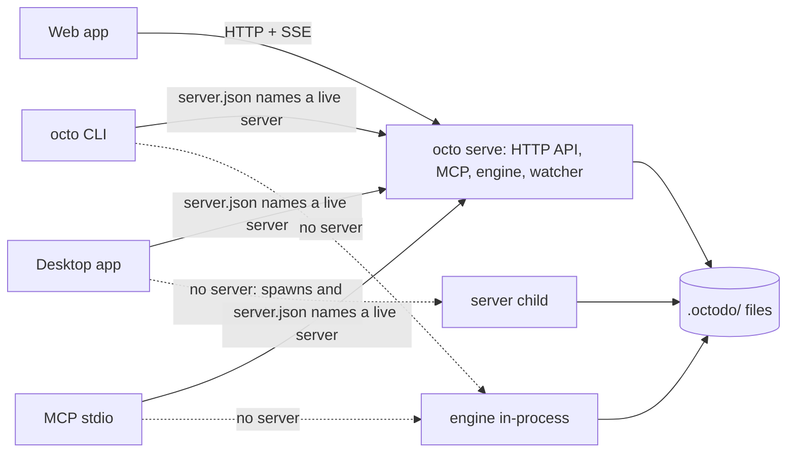

# Architecture

This page explains which process and which package does what, as the code is today. When a change
moves a process's or a package's job, update this page in the same commit. A planned design that the
code does not match yet goes under a "Target" heading next to the "Today" one, until it lands.

## Processes

### Today

- `octo serve` runs the HTTP server: the API at `/api`, MCP at `/mcp`, the change feed, the web
  app. Once it listens it writes `<home>/server.json` (`url`, `pid`, `version`), and removes it
  when it closes.
- `octo <command>` and `octo mcp` go through `connect()` from `@octodo/client`. A server that
  `server.json` names and that answers `/api/health` with the same version runs every call over
  HTTP. With no server, a dead pid or a refused connection, the engine runs in-process; a server of
  another version, or one that does not answer, is reported instead
  ([0018](decisions/0018-connect-finds-the-server-through-server-json.md)).
- The desktop app attaches to the server `server.json` names when it answers with the same
  version, and otherwise spawns one: its own binary with `ELECTRON_RUN_AS_NODE=1`, running
  `startServer` (`apps/desktop/src/server.ts`). It restarts a child that crashes, with a backoff,
  and on 4520 or the port the last child had. A server of another version, one that does not
  answer, or a child that keeps crashing is shown in the window with Try Again and Quit. The window
  loads the web app from the server's origin. Quitting stops the child; an attached server keeps
  running ([0021](decisions/0021-the-desktop-app-attaches-to-or-spawns-the-server.md)). The
  packaged app runs that child from inside `app.asar` and keeps Electron's `RunAsNode` fuse on for
  it, with the other fuses off where the app does not use them
  ([0024](decisions/0024-the-desktop-app-is-packaged-with-electron-builder.md)).
- `octo serve` refuses to start while `server.json` names a server that answers, and a server holds
  a lock on its home (`<home>/.server-lock`) while it runs, so two started together run one
  ([0026](decisions/0026-a-server-claims-its-home-with-a-lock.md)). That one server serves the web
  app, the desktop window and MCP over HTTP
  ([0002](decisions/0002-server-preferred-topology.md)).

Several processes can still open one workspace, so each write holds the workspace's owner lock
(`.octodo/.owner-lock`, [0003](decisions/0003-one-writer-per-workspace.md)) and the others wait for
it. The holder assigns new ids from its own scan.

## Packages

### Today

| Package             | What                                                                                                                                                                                                                                                                                                                                                                                                                                                                                                                                                                                                                                                                                                                                                                                                                                                                                                                                                                                                                                                                                                                                                                                                                                                                                                                                                                                                                                                                                                                                                                                                                                                                                                                                                                                                                                                                                                                                                                                                                                                                                                                                                                                                                                                                                                                                                                                                                                                                                                                                                                                                                                                                                                                                                                                                                                                                                                                                                                                                                                                                                                                                                                                                                                                                                                                                                                                             |
| ------------------- | ------------------------------------------------------------------------------------------------------------------------------------------------------------------------------------------------------------------------------------------------------------------------------------------------------------------------------------------------------------------------------------------------------------------------------------------------------------------------------------------------------------------------------------------------------------------------------------------------------------------------------------------------------------------------------------------------------------------------------------------------------------------------------------------------------------------------------------------------------------------------------------------------------------------------------------------------------------------------------------------------------------------------------------------------------------------------------------------------------------------------------------------------------------------------------------------------------------------------------------------------------------------------------------------------------------------------------------------------------------------------------------------------------------------------------------------------------------------------------------------------------------------------------------------------------------------------------------------------------------------------------------------------------------------------------------------------------------------------------------------------------------------------------------------------------------------------------------------------------------------------------------------------------------------------------------------------------------------------------------------------------------------------------------------------------------------------------------------------------------------------------------------------------------------------------------------------------------------------------------------------------------------------------------------------------------------------------------------------------------------------------------------------------------------------------------------------------------------------------------------------------------------------------------------------------------------------------------------------------------------------------------------------------------------------------------------------------------------------------------------------------------------------------------------------------------------------------------------------------------------------------------------------------------------------------------------------------------------------------------------------------------------------------------------------------------------------------------------------------------------------------------------------------------------------------------------------------------------------------------------------------------------------------------------------------------------------------------------------------------------------------------------------ |
| `packages/contract` | `@octodo/contract`, what every client shares. `domain.ts` holds the Effect schemas of the snapshot, the inputs, the operations' results and the errors; `catalog.ts` (`@octodo/contract/catalog`, kept out of the browser) declares every operation once: its input, success, errors, HTTP path and CLI command ([0005](decisions/0005-one-operation-catalog.md)); `api.ts` (`@octodo/contract/api`) is the HttpApi definition generated from it plus the `app` endpoints, and `client.ts` (`@octodo/contract/client`) the browser's typed `fetch` client, typed from it with type-only imports; `plugin.ts` (`@octodo/contract/plugin`) the `PluginShared` shape of a plugin's shared half; `presets.ts` (`@octodo/contract/presets`, plain data the browser imports) the workspace presets; `rules.ts` the plain functions the browser runs for every keystroke, drag hover and optimistic update and the engine runs the same way: status order and categories, list moves and depth, `taskSubtree`, `destination`, `findMentions`, `LINK_KINDS`, `readiness` (the blocked and ready rule) and `isProblem` (a note is not a problem). Lint keeps Node and the engine out of the package, and Effect out of `rules.ts`.                                                                                                                                                                                                                                                                                                                                                                                                                                                                                                                                                                                                                                                                                                                                                                                                                                                                                                                                                                                                                                                                                                                                                                                                                                                                                                                                                                                                                                                                                                                                                                                                                                                                                                                                                                                                                                                                                                                                                                                                                                                                                                                                                                        |
| `packages/engine`   | Effect domain over the files: storage, scan, markdown round-trip, the folder grammar, `Workspace` and `Workspaces`. `storage/` is the only code that touches the disk ([0012](decisions/0012-only-storage-touches-the-disk.md)): `storage.ts` is `makeStorage(root)`, whose `read` returns `{ config, tree }` and whose `write((files, ids) => ...)` runs under the owner lock with the only operations that change files and the only source of new task ids; `files.ts` those operations (atomic writes, folders built under a dot name, removals that rename to one first, each reporting the paths it touched to the cache) and the temporary names; `config.ts` the one reader of `config.json`; `tree.ts` the one reader of the folder grammar (task, list and markdown entries with their texts, which writes edit instead of opening a file again, and what the grammar does not read as problems, at most 32 file system calls at once per process, through a cache that writes and the watcher invalidate, and that each read forgets once a watcher has stopped; a one-shot `octo` command opens without one and keeps it); `owner-lock.ts` the owner lock; `bookkeeping.ts` octodo's dot names and the cleanup of a crashed write's leftovers; `home.ts` `<home>/workspaces.json`, `<home>/server.json` and the folder picker's listing. `scan.ts` is a pure function from a storage read to a snapshot (lists, tasks, links, every diagnostic), with where each list and task is on disk and the text of each file it read. The operations live in domain folders that never open a file or list a folder: `tasks/` (create, update, move, delete and attachments, which it lists, reads and saves, with `media-type.ts` the one lookup of an attachment's media type; `task-file.ts` reads and writes `task.md`, `links.ts` adds what other tasks say about a task, with `blocked` and `ready` from the contract's readiness rule), `lists/` (create and move; `list-file.ts`), `statuses/` (reorder, and the statuses a snapshot shows), `settings/` (enabling and disabling a plugin in `config.json`) and `health/` (fix and fix-all; `problems.ts` is the `PROBLEMS` table, `fixes.ts` the fixes). `layout.ts` is the on-disk grammar (file names, task id formats, folder names); `place.ts` computes order keys among siblings; `siblings.ts` writes renumbered order keys and finds a container's folder; `frontmatter.ts` edits frontmatter through the YAML document; `state.ts` keeps the last scan, gives ids to files without one, and lets writes take turns with reads; `workspace.ts` maps each `Workspace` method to its domain function; `operations.ts` binds each catalog operation to its handler on a `Workspace`, typed from the catalog, and `runOperation` runs one for any surface. `plugins/` is the plugin API ([0014](decisions/0014-one-plugin-api-for-the-plain-task-and-every-plugin.md)): `plugin.ts` `plainTask` (the plain task's keys and catalog), `definePlugin`, the `PluginWorkspace` a plugin's handlers get, and `checkPlugins`; `kinds.ts` reads a task's `type` against the enabled plugins and has its plugin compute `kind`; `registry.ts` `makeRegistry`, every operation with the plugins' and the one `run` that refuses a plugin the workspace does not enable. Lint fails a `FileSystem` or `node:fs` import outside `storage/`. |
| `packages/plugins`  | `@octodo/plugins`: `plugins`, every first-party plugin's engine half, which the processes give `Workspaces.layer`, and `./web` (`webPlugins`, each plugin's `PluginWeb`) for the app. Each plugin is a folder with `shared.ts`, `engine.ts` and `web.tsx`: `recurring/` is the recurring task ([0016](decisions/0016-recurring-tasks-complete-in-place.md)), with `rule.ts` (the `repeat` grammar and next due day); `counter/` the days-since counter ([0019](decisions/0019-days-since-counters-share-the-occurrence-log.md)), with `days.ts` (calendar days); `anniversary/` a date that comes back every year ([0020](decisions/0020-anniversaries-store-the-day-clients-compute-the-next.md)), with `day.ts` (the next occurrence, which the CLI label and the web half compute from today); `log.ts` is `log.jsonl`, which recurring tasks and counters both own; `test/tally/`, next to `src/` and with no web half, is the test plugin that proves the API. A web half renders with `@octodo/ui` and calls its own operations through `@octodo/contract/client` typed from them ([0017](decisions/0017-the-ui-kit-is-a-package-plugins-type-their-own-client.md)); lint keeps `apps/web` out of the package                                                                                                                                                                                                                                                                                                                                                                                                                                                                                                                                                                                                                                                                                                                                                                                                                                                                                                                                                                                                                                                                                                                                                                                                                                                                                                                                                                                                                                                                                                                                                                                                                                                                                                                                                                                                                                                                                                                                                                                                                                                                                                                                                                              |
| `packages/mcp`      | MCP tools generated on Effect's `McpServer` from a registry's operations and a function that runs them: a `Toolkit` of the operations that return a value, `McpServer.addTool` for `read_attachment` (an image, text or an embedded file). `stdioLayer` takes the run function of the CLI's `Connection`; `httpLayer` runs them on the server's `Workspaces`                                                                                                                                                                                                                                                                                                                                                                                                                                                                                                                                                                                                                                                                                                                                                                                                                                                                                                                                                                                                                                                                                                                                                                                                                                                                                                                                                                                                                                                                                                                                                                                                                                                                                                                                                                                                                                                                                                                                                                                                                                                                                                                                                                                                                                                                                                                                                                                                                                                                                                                                                                                                                                                                                                                                                                                                                                                                                                                                                                                                                                     |
| `packages/server`   | Effect HttpApi server on 127.0.0.1 in one router: the `Api` endpoints (the operations of `makeRegistry(plugins)`, the catalog's and the plugins', in one loop, `app` endpoints by hand, [0015](decisions/0015-http-endpoints-outside-the-catalog.md)), OpenAPI at `/api/openapi.json`, MCP at `/mcp`, the SSE change feed and the static web app ([0006](decisions/0006-effect-httpapi-replaces-hono.md)). `startServer` claims the home (`home-claim.ts`, [0026](decisions/0026-a-server-claims-its-home-with-a-lock.md)), writes `<home>/server.json` once it listens and removes it on `close()`; a `:workspace` path parameter, and the `workspace` of an MCP tool at `/mcp`, is a registered id or an absolute folder                                                                                                                                                                                                                                                                                                                                                                                                                                                                                                                                                                                                                                                                                                                                                                                                                                                                                                                                                                                                                                                                                                                                                                                                                                                                                                                                                                                                                                                                                                                                                                                                                                                                                                                                                                                                                                                                                                                                                                                                                                                                                                                                                                                                                                                                                                                                                                                                                                                                                                                                                                                                                                                                       |
| `packages/client`   | `@octodo/client`: `connect()` and the `Connection` service. Each call reads `<home>/server.json`, probes `/api/health` once per server, and runs on that server over HTTP (`remote.ts`, through `@octodo/contract/client`, decoding results and errors back to the engine's) or on the engine in-process (`embedded.ts`) ([0018](decisions/0018-connect-finds-the-server-through-server-json.md))                                                                                                                                                                                                                                                                                                                                                                                                                                                                                                                                                                                                                                                                                                                                                                                                                                                                                                                                                                                                                                                                                                                                                                                                                                                                                                                                                                                                                                                                                                                                                                                                                                                                                                                                                                                                                                                                                                                                                                                                                                                                                                                                                                                                                                                                                                                                                                                                                                                                                                                                                                                                                                                                                                                                                                                                                                                                                                                                                                                                |
| `packages/cli`      | `octo` on `effect/cli`. `commands.ts` generates one command per operation of `makeRegistry(plugins)`, with flags from `schema-flags.ts` and text from `render.ts`; `skill.ts` generates the agent skill; `octo.ts` adds the commands that are not operations (`doctor`, `init`, `workspace remove`, `serve`, `mcp`, `skills export`) and runs every call through the `Connection`; `main.ts` runs it                                                                                                                                                                                                                                                                                                                                                                                                                                                                                                                                                                                                                                                                                                                                                                                                                                                                                                                                                                                                                                                                                                                                                                                                                                                                                                                                                                                                                                                                                                                                                                                                                                                                                                                                                                                                                                                                                                                                                                                                                                                                                                                                                                                                                                                                                                                                                                                                                                                                                                                                                                                                                                                                                                                                                                                                                                                                                                                                                                                             |
| `packages/ui`       | `@octodo/ui`, the UI kit the app and the plugins' web halves share ([0017](decisions/0017-the-ui-kit-is-a-package-plugins-type-their-own-client.md)): the shadcn components (`components/`) and `PropertyChip`, the new-task dialog's property button that plugins use too, `cn`, `use-mobile`, the date labels rows show (`lib/dates.ts`, given the day they are shown on) and `use-today`, the day every relative label and the date views count from, which changes at local midnight and when the window comes back, and `styles.css`, the design tokens and fonts, which `@source`s its own folder for Tailwind. It imports no octodo package and no app (lint)                                                                                                                                                                                                                                                                                                                                                                                                                                                                                                                                                                                                                                                                                                                                                                                                                                                                                                                                                                                                                                                                                                                                                                                                                                                                                                                                                                                                                                                                                                                                                                                                                                                                                                                                                                                                                                                                                                                                                                                                                                                                                                                                                                                                                                                                                                                                                                                                                                                                                                                                                                                                                                                                                                                             |
| `apps/web`          | Vite and React; imports types from `@octodo/contract`, values from `@octodo/contract/rules`, `@octodo/contract/presets` and `@octodo/contract/client`, its components from `@octodo/ui` and the plugins' web halves from `@octodo/plugins/web`, never `@octodo/engine` (lint)                                                                                                                                                                                                                                                                                                                                                                                                                                                                                                                                                                                                                                                                                                                                                                                                                                                                                                                                                                                                                                                                                                                                                                                                                                                                                                                                                                                                                                                                                                                                                                                                                                                                                                                                                                                                                                                                                                                                                                                                                                                                                                                                                                                                                                                                                                                                                                                                                                                                                                                                                                                                                                                                                                                                                                                                                                                                                                                                                                                                                                                                                                                    |
| `apps/desktop`      | Electron shell. `main.ts` owns the window; `backend.ts` attaches to the server or spawns, restarts and stops a child running `server.ts`; `problem.ts` is the page that shows why there is no server; `pnpm package` builds the macOS app with electron-builder ([0024](decisions/0024-the-desktop-app-is-packaged-with-electron-builder.md))                                                                                                                                                                                                                                                                                                                                                                                                                                                                                                                                                                                                                                                                                                                                                                                                                                                                                                                                                                                                                                                                                                                                                                                                                                                                                                                                                                                                                                                                                                                                                                                                                                                                                                                                                                                                                                                                                                                                                                                                                                                                                                                                                                                                                                                                                                                                                                                                                                                                                                                                                                                                                                                                                                                                                                                                                                                                                                                                                                                                                                                    |

## Extensibility

Task kinds are first-party plugins that each workspace enables in its `config.json`. The plain task
is the built-in kind, registered through the same API
([0007](decisions/0007-first-party-plugins-per-workspace.md),
[0014](decisions/0014-one-plugin-api-for-the-plain-task-and-every-plugin.md)). Presets are data
copied into a new workspace's `config.json`
([0008](decisions/0008-statuses-per-workspace-presets-as-data.md)): `PRESETS` in
`@octodo/contract/presets` (Checklist, Project, Chores), which `add_workspace` takes and the app's
add-workspace dialog imports. `list_plugins`, `enable_plugin` and `disable_plugin` list the plugins
octodo has and change a workspace's `plugins`; the app's Settings > Plugins page calls them
([0022](decisions/0022-presets-in-the-contract-workspace-and-plugin-settings-are-operations.md)).

### The plugin API

A plugin is one kind of task, named by its id in config.json's `plugins` and in a task's `type`.

| Half     | Where                | What                                                                                                                                                                                                                                                                                                                                                                                                                                                                                                                                                                   |
| -------- | -------------------- | ---------------------------------------------------------------------------------------------------------------------------------------------------------------------------------------------------------------------------------------------------------------------------------------------------------------------------------------------------------------------------------------------------------------------------------------------------------------------------------------------------------------------------------------------------------------------- |
| `shared` | `<plugin>/shared.ts` | A `PluginShared`: its frontmatter `keys` (a struct), its `files` in a task folder, the `fields` it computes, its `operations` (catalog entries), the remedy of each of its `problems`, the CLI's `label` and `day`, the day a task of the kind is due on, a plain function from its own module ([0025](decisions/0025-a-kind-gives-its-due-day-and-list-tasks-filters-by-it.md))                                                                                                                                                                                       |
| `engine` | `<plugin>/engine.ts` | `definePlugin(shared, { read, handlers, complete })`: `read` turns a task's keys and files into `{ fields, problems }`; each handler gets a `PluginWorkspace` with `createOfKind`, `editOfKind` and `filesOfKind`; `complete` is what a move into a completed status writes instead of closing the task                                                                                                                                                                                                                                                                |
| `web`    | `<plugin>/web.tsx`   | A `PluginWeb`: `Row` in a task row's date slot, `Panel` in the task panel, `day` (the shared half's own function, which Today and Next 7 days read), `completesInPlace` for the optimistic move, and `create`, the kind's entry in the new-task dialog's kind picker with its own fields and its create call ([0023](decisions/0023-plugins-contribute-their-create-fields-and-own-the-date-slot.md)); the app's seam is `components/task-kind.tsx`. It renders with `@octodo/ui` and calls its operations through `createClient<ServedApi<typeof shared.operations>>` |

- The plain task is `plainTask`, a `PluginShared` whose keys are the ones `task.md` has and whose
  operations are the catalog. A plugin can claim none of them, nor another plugin's kind, key
  or operation: `makeRegistry` and `Workspaces.layer` throw at startup.
- A task of an enabled kind has `kind: { id, fields }`, and its plugin's keys leave `extra`. Any
  other `type` is a plain task with an `unknown-kind` diagnostic. The snapshot and `get_workspace`
  give the enabled `plugins`.
- A plugin's files, in tasks of its kind, are read by the tree for its reader and are never
  attachments. Two plugins may own one file name, since the task's kind picks its reader. Its problems are diagnostics of kind `<plugin>/<problem>`.
- Every installed plugin's operations appear on MCP, the CLI (under a group named by their first
  word, `octo recurring ...`) and the skill; in a workspace that does not enable the plugin they
  fail with `PluginNotEnabled`. `list_tasks` gives each task's `kind`, and the CLI appends the
  shared half's `label` to a task line.
- A task's due day is `taskDay` in `@octodo/contract/rules`: a plain task's `due`, or its kind's
  `day` from today. `list_tasks`' `due_by` (`octo list --due-by`) and the app's Today and Next 7
  days list by `isDueBy` over it, so they agree
  ([0025](decisions/0025-a-kind-gives-its-due-day-and-list-tasks-filters-by-it.md)).
